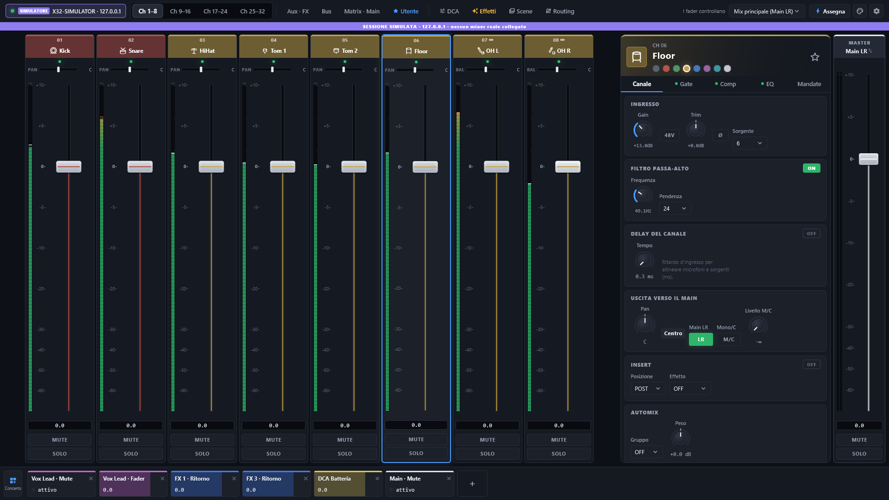

  <picture>
    <source media="(prefers-color-scheme: dark)" srcset="branding/out/logo_scuro.svg">
    
  </picture>

<b>Controller da PC per i mixer digitali della famiglia Behringer X32 / Midas M32</b> 
Windows x64 · OSC sulla rete locale · progetto indipendente

  <a href="../../releases/latest">Scarica l'ultima versione</a> ·
  <a href="docs/COMPATIBILITY.md">Compatibilità</a> ·
  <a href="docs/NETWORK_SETUP.md">Rete</a> ·
  <a href="docs/KNOWN_LIMITATIONS.md">Limitazioni</a> ·
  <a href="README.md">English</a>

> **Mixora è un progetto indipendente**: non è affiliato, approvato o sostenuto da Behringer, Midas o Music Tribe.
> X32 e M32 sono marchi dei rispettivi proprietari e qui servono solo a indicare la compatibilità.

## Cosa fa

* Vista mixer con 8 o 16 strip per pagina, ritorni Aux/FX, bus, matrici, main e DCA.
* Editor del canale: gain/trim, fase, filtro passa-alto, delay, gate e compressore con **riduzione di guadagno** reale, EQ parametrico a 4 bande con grafico, mandate.
* Meter dei canali, rack degli effetti con editor grafici, panoramica del routing (modifica bloccata per impostazione predefinita), scene, snippet e cue.
* Layer utente, barra dei controlli rapidi, scorciatoie da tastiera, temi colore, modalità touch.
* **Sicura:** il collegamento *legge* soltanto lo stato del mixer; nulla cambia finché non muovi un controllo.
* **Simulatore integrato** per provare Mixora senza mixer.
* **Sei lingue:** italiano, English, Español, Français, Deutsch, Português (automatica da Windows, o scelta nelle *Impostazioni*).

## Compatibilità

| Mixer | Firmware | Stato |
|---|---|---|
| Behringer X32 Producer | 4.15 | **Verificata** per le funzioni essenziali |
| Altri modelli X32 | — | Non verificati |
| Famiglia Midas M32 | — | Non verificata |

Dettagli in [docs/COMPATIBILITY.md](docs/COMPATIBILITY.md).

## Requisiti

Windows 10 o 11 a 64 bit, PC sulla **stessa rete del mixer** (cavo o Wi-Fi del router). Internet non serve. Nessun altro software richiesto.

## Installazione

1. Scarica `Mixora-<versione>-setup.exe` dall'[ultima release](../../releases/latest) e, se vuoi, controlla l'impronta SHA-256 pubblicata.
2. Avvia l'installer: per impostazione predefinita installa solo per il tuo utente e **non chiede i permessi di amministratore**.
3. Windows potrebbe mostrare l'avviso SmartScreen perché l'installer non è ancora firmato digitalmente (vedi [docs/CODE_SIGNING.md](docs/CODE_SIGNING.md)).

## Collegamento al mixer

1. PC sulla stessa rete del mixer: l'hotspot del telefono è un'altra rete.
2. Al primo avvio scegli **Cerca il mixer** o **Prova con il simulatore**.
3. Scegli il mixer trovato o scrivi il suo indirizzo IP (sul mixer: *Setup → Network*).

## Segnalazioni

Apri una [segnalazione](../../issues/new/choose) indicando versione di Mixora, versione di Windows, modello e firmware del mixer, cosa hai fatto e cosa è successo; allega il file di diagnostica (*Impostazioni → Diagnostica*) dopo averlo controllato.

## Licenza

Mixora è software libero, distribuito con la **GNU General Public License versione 3 o, a tua scelta, successiva** (GPL-3.0-or-later): vedi [LICENSE](LICENSE). Puoi usarlo, studiarlo, condividerlo e modificarlo; se lo distribuisci, anche modificato, devi farlo con la stessa licenza e rendere disponibile il codice sorgente. Nessuna garanzia. Componenti di terze parti: [THIRD_PARTY_NOTICES.md](THIRD_PARTY_NOTICES.md).
