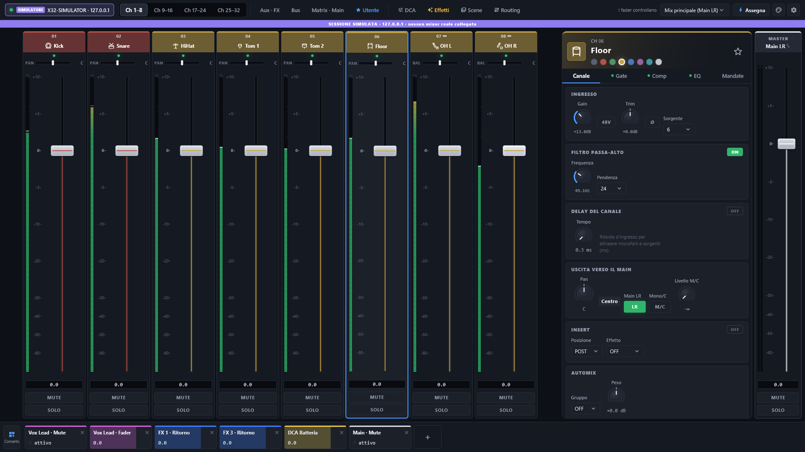
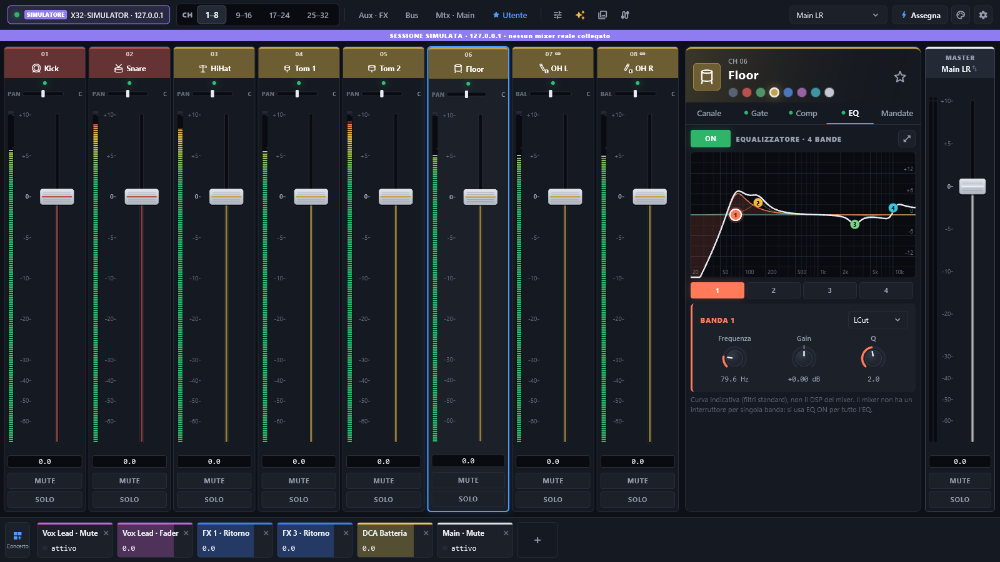
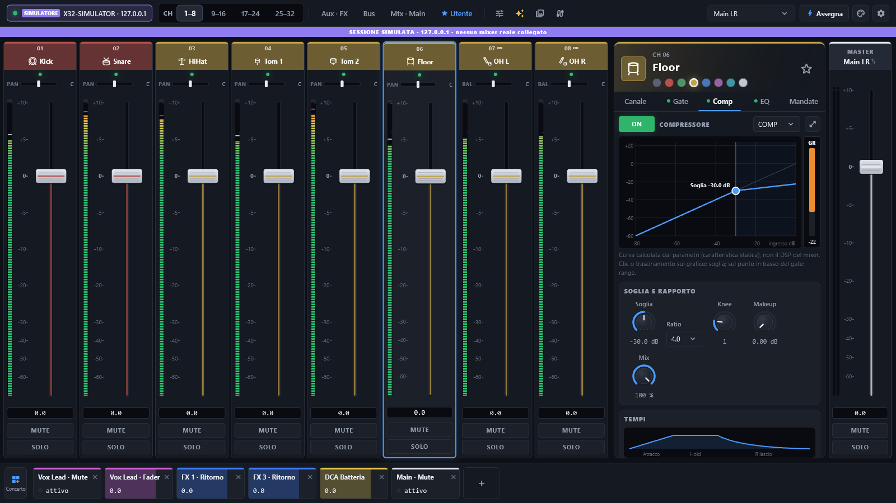
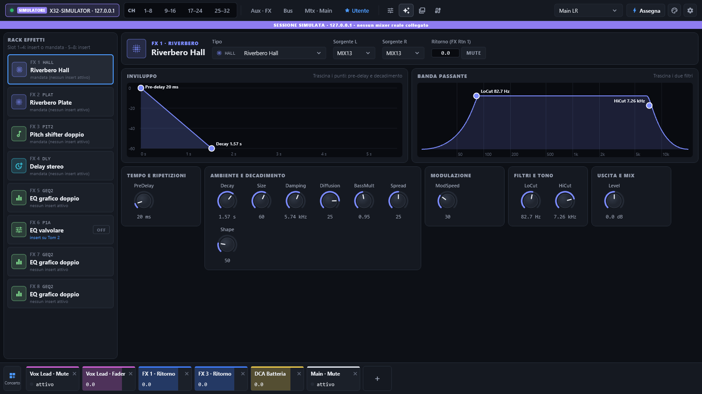

  <picture>
    <source media="(prefers-color-scheme: dark)" srcset="branding/out/logo_scuro.svg">
    
  </picture>

<h1 align="center">Fadera — X32/M32 mixer controller</h1>

<b>A desktop controller for Behringer X32 / Midas M32 family digital mixers</b> 
Windows x64 · OSC over your local network · independent project

  <a href="../../releases/latest">Download the latest release</a> ·
  <a href="docs/COMPATIBILITY.md">Compatibility</a> ·
  <a href="docs/NETWORK_SETUP.md">Network setup</a> ·
  <a href="docs/KNOWN_LIMITATIONS.md">Known limitations</a> ·
  <a href="README.it.md">Italiano</a>

> **Fadera is an independent project.** It is not affiliated with, endorsed or supported by Behringer, Midas or Music Tribe.
> X32 and M32 are trademarks of their respective owners and are used here only to describe compatibility.

## What it does

Fadera controls a digital mixer from a Windows PC over the network, using the mixer's OSC remote protocol.

* **Mixer view** with 8 or 16 channel strips per page, Aux/FX returns, buses, matrices, main and DCA.
* **Channel editor:** gain/trim, phase, high-pass filter, delay, gate and compressor with live **gain reduction**, 4-band parametric EQ with graph, sends.
* **Meters** for channels, with configurable peak hold and fall-back speed.
* **Effects rack** with graphical editors for reverbs, delays, modulation, EQs and more.
* **Routing overview** (editing is locked by default), **scenes, snippets and cues**.
* **User layer**: build your own page of strips from any category.
* **Quick controls** bar, keyboard shortcuts, colour themes, touch mode.
* **Find a channel with Ctrl+F:** type a name ("Kick") or a reference ("12", "bus 3", "dca 2") and Fadera opens the right page.
* **Clear warnings:** a notice tells you when the mixer stops responding and when it is back; the top bar counts the changes that did not reach the mixer meanwhile.
* **Settings on file:** export appearance, layouts, shortcuts and preferences, and import them on another PC (*Settings → General*).
* **Readable and accessible:** secondary text meets WCAG AA contrast; faders, knobs and strips are announced by screen readers.
* **Safe by design:** connecting only *reads* the mixer state; nothing is changed until you move a control. Commands typed while the mixer is unreachable are discarded, never replayed later.
* **Six languages:** English, Italiano, Español, Français, Deutsch, Português (automatic from Windows, or chosen in *Settings*).

| Channel EQ | Compressor with gain reduction | Effects |
|---|---|---|
|  |  |  |

## Compatibility

Only what has been tested on real hardware is listed as verified. See [docs/COMPATIBILITY.md](docs/COMPATIBILITY.md) for the full matrix.

| Mixer | Firmware | Status |
|---|---|---|
| Behringer X32 Producer | 4.15 | **Verified** for the essential functions (connection, sync, faders, mute, solo, pan, channel processing, EQ, dynamics, sends, DCA, meters, reconnection) |
| Other X32 models (Full, Compact, Rack, Core) | — | Not verified (same protocol family, expected to work, not tested) |
| Midas M32 family | — | Not verified |

Not yet verified on hardware even on the X32 Producer: effects changes, scene save/recall, routing changes, bus/matrix/main control from the PC, phantom power.

## System requirements

* Windows 10 or Windows 11, 64-bit (x64).
* A network connection to the mixer: Ethernet or Wi-Fi **on the same network as the mixer**. Internet access is not needed.
* No other software is required (no Flutter, no runtime installers).

## Installation

1. Download `Fadera-<version>-setup.exe` from the [latest release](../../releases/latest).
2. Optionally verify the download against the `.sha256` file published with the release:
   `Get-FileHash .\Fadera-<version>-setup.exe -Algorithm SHA256`
3. Run the installer. By default it installs for the current user only and **does not need administrator rights**; you can choose a folder and an optional desktop shortcut.

A portable ZIP is also available: extract it anywhere and run `Fadera.exe`.

> **Windows SmartScreen:** the installer is not yet digitally signed, so Windows may show "Windows protected your PC". Choose *More info → Run anyway* only if the file's SHA-256 matches the published one. See [docs/CODE_SIGNING.md](docs/CODE_SIGNING.md).

Uninstall from *Settings → Apps → Installed apps*. Your preferences in `%APPDATA%\Fadera` are kept; delete that folder to remove them.

## Connecting to the mixer

1. Connect the PC to the **same network as the mixer**: the same router/switch by cable, or that router's Wi-Fi. A phone hotspot is a different network and will not see the mixer.
2. Start Fadera. On first launch a short welcome screen offers **Search for the mixer**.
3. Fadera searches on every network adapter. Pick your mixer, or type its IP address (shown on the mixer under *Setup → Network*).
4. Fadera reads the mixer state (Mixer → PC). Nothing is written to the mixer during this step.

If no mixer is found, the Connect window explains why (for example *"the PC is on a different network"*). More in [docs/NETWORK_SETUP.md](docs/NETWORK_SETUP.md).

## Known limitations

See [docs/KNOWN_LIMITATIONS.md](docs/KNOWN_LIMITATIONS.md). In short: only Windows x64 is released; only the X32 Producer with firmware 4.15 has been tested; some advanced features have not yet been verified on hardware; the installer is not signed.

## Reporting problems

Please open an [issue](../../issues/new/choose) and include:

* Fadera version (*Settings → Informazioni*), Windows version, mixer model and firmware;
* what you did and what happened;
* the diagnostics file exported from *Settings → Diagnostica* (review it first: it contains your mixer's IP address and channel names).

Security issues: see [SECURITY.md](SECURITY.md).

## Building from source

See [docs/BUILDING.md](docs/BUILDING.md). The project uses Flutter (Windows desktop) and pure-Dart packages for the protocol engine and for the mixer simulator used by the automated tests. Every push is built and tested by GitHub Actions.

## License

Fadera is free software, released under the **GNU General Public License, version 3 or (at your option) any later version** (GPL-3.0-or-later). See [LICENSE](LICENSE).

You may use, study, share and modify it. If you distribute it, modified or not, you must do so under the same license and make the source code available.
Fadera comes with no warranty. Third-party components and their licenses: [THIRD_PARTY_NOTICES.md](THIRD_PARTY_NOTICES.md).
